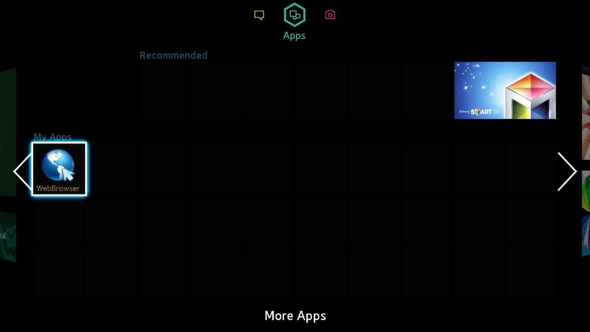

# SamsungF — Samsung UE40F6650 emulator prototype

SamsungF runs the original **2013 Samsung Orsay firmware** in a custom QEMU
machine, `samsung_mstar_ue40f6650`. This is an independent preservation and
reverse engineering project for the **UE40F6650 / T-MST12DEUC** family.
SamsungF has its own repository, patch series, tools and research notes;
QEMU is its underlying execution engine.

The prototype boots Samsung's Linux kernel, runs its original applications,
and has reached the **interactive Smart Hub Apps dashboard at 1920×1080**.
Rendering and peripheral emulation are still incomplete.



This image is a capture of the running guest. The WebBrowser tile can be
selected with the emulated remote. Launching it executes the original browser
startup routines, but its visible window currently stays black.

> AI was used in the development

## What is included

| Folder or file | Contents |
| --- | --- |
| [patches/](patches/) | Three ordered text patches against **QEMU v10.1.0**, with source and patch hashes |
| [screenshots/](screenshots/README.md) | Six original guest captures, with captions, dimensions and hashes |
| [tools/](tools/) | Patch application, local disk preparation, a launcher, browser remote and synthetic component checks |
| [Build and run](docs/build-and-run.md) | Linux and Windows build instructions, firmware prerequisites and launch commands |
| [NOTES.md](NOTES.md) | Recovered registers, board assumptions and remaining hardware work |
| [Validation](docs/validation.md) | Checks performed on this snapshot and their limits |

Samsung firmware, extracted applications, disk images, certificates and VM
state are supplied locally by the person running the emulator. The repository
contains no firmware payloads. It stores only their filenames, sizes and hashes
in [the firmware manifest](docs/firmware-manifest.json).

## Current behavior

| Area | Status |
| --- | --- |
| Original Linux 3.0.33 kernel and BusyBox shell | Boots through direct kernel loading |
| Original root and application filesystems | Mounted through the FCIE/eMMC model using a synthetic GPT disk |
| Samsung settings and Smart Hub setup | Visible and controlled by MICOM remote input |
| Smart Hub agreement and Apps dashboard | Completed in the retained research VM through the optional TLS bridge |
| GE, Mali and GOP | Guest RAM drawing, shader execution, textured triangles and layer composition |
| Wired networking | Original gateway and HTTP setup tests pass |
| Built-in WebBrowser | Original launch code executes; visible browser output remains black |
| Broadcast TV, video decoding and audio | Incomplete |
| BootROM, MBOOT/U-Boot and Samsung secure OS | Incomplete; the prototype loads the kernel directly |

The Smart Hub screenshots were taken after ordinary setup navigation and
required agreement, with optional sharing disabled. The launcher does not
automate agreement. Setup persistence after restarting the VM is unverified;
each launch uses temporary disk writes.

## Build and try it

Use a clean QEMU **v10.1.0** checkout at commit
`f8b2f64e2336a28bf0d50b6ef8a7d8c013e9bcf3`. Apply the series using
`tools/apply_patches.py`, build `arm-softmmu`, and prepare a synthetic disk from
your extracted **T-MST12DEUC 1112.2** images. Full commands are in
[Build and run](docs/build-and-run.md).

Once those inputs exist, a Linux launch from this repository looks like:

```sh
python3 tools/run_orsay.py \
  --qemu build/qemu-system-arm \
  --kernel /path/to/private/images/uImage \
  --disk /path/to/private/tv.raw
```

The launcher opens a viewer on `http://127.0.0.1:<port>/`. Its buttons send
remote keys to the original firmware. **Stop TV** or **Ctrl+C** ends the VM.
Use `--offline` to disconnect Ethernet, or `--no-open` to print the address.

Smart Hub's legacy HTTPS calls need the optional `--hubsite-ca` bridge for the
setup path shown in the screenshots. Its modern upstream connection verifies
the original server certificate and hostname using the firmware's recovered
CA. Server availability and responses can change. Offline menus and network
setup do not establish that online services or app downloads work.

## Hardware fidelity

The target panel is **1920×1080** and the owner reports **512 MiB RAM**. The
launcher selects two Cortex-A9 cores and `-m 512M`, but the current machine also
allocates separate vendor and display memory regions. Its total backed memory
**exceeds 512 MiB**; the physical DRAM layout is still unresolved.

Register addresses come from the supplied firmware. CPU configuration, clocks,
panel straps, orientation, factory contents and device timing include explicit
emulator assumptions. The default launcher rotates the composed panel by 180°
for upright output in this profile. This does not establish how the physical
panel is mounted. See [board notes](NOTES.md).

This is a research prototype, with long startup delays and incomplete background
and color rendering. The introduction page contains Samsung's promotional app
image; it is documented separately from the interactive Apps dashboard.

## License and provenance

New emulator and helper code uses **GPL-2.0-or-later**; the license text is in
[LICENSE](LICENSE). Existing QEMU notices remain in the patch context.
Samsung UI artwork and trademarks shown in screenshots retain their original
ownership. See [third-party notices](THIRD_PARTY_NOTICES.md).

The project maintains its own QEMU patch series. No upstream QEMU submission
is part of this prototype.
