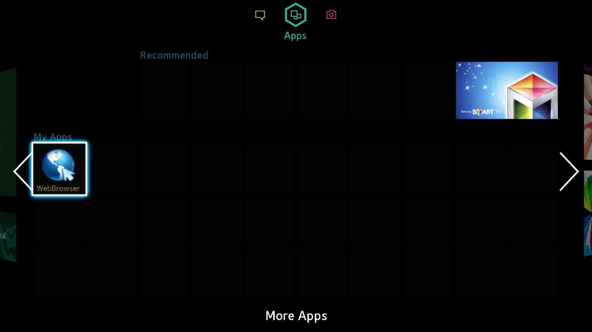
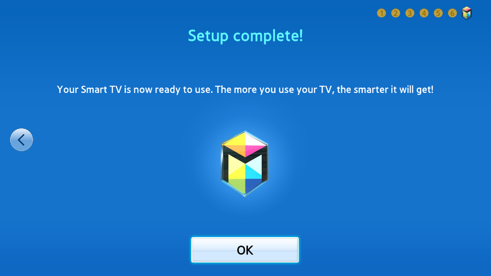
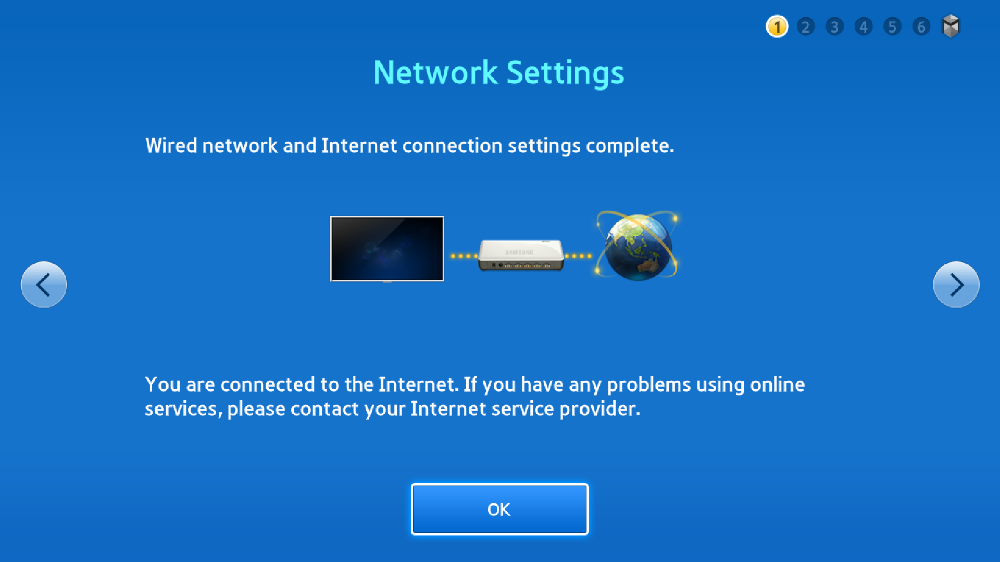
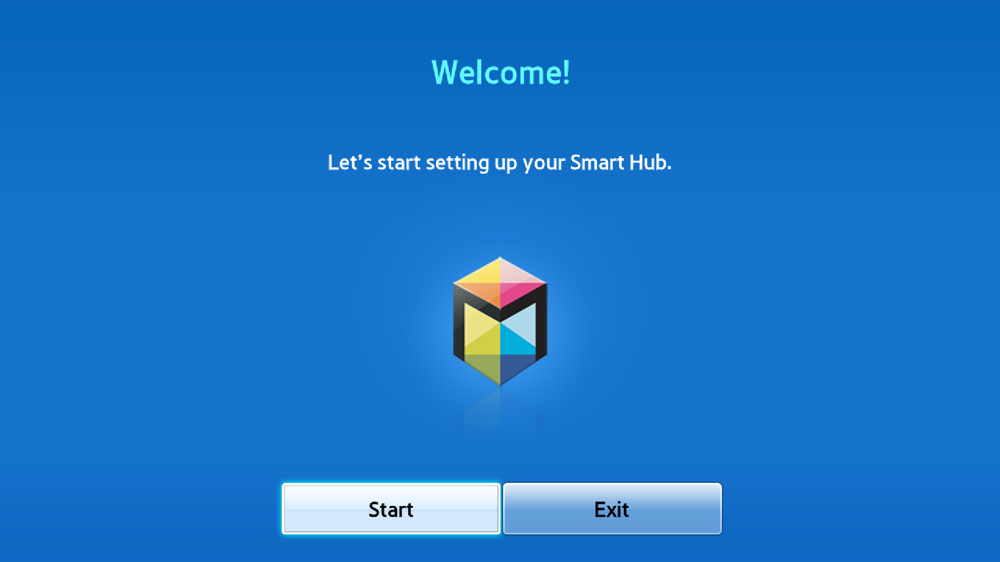
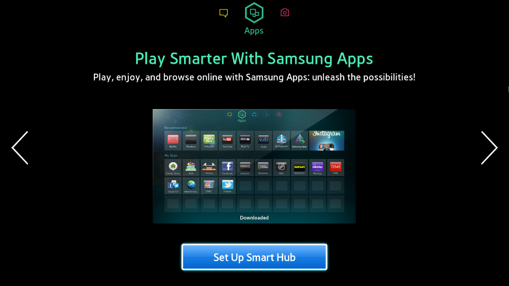
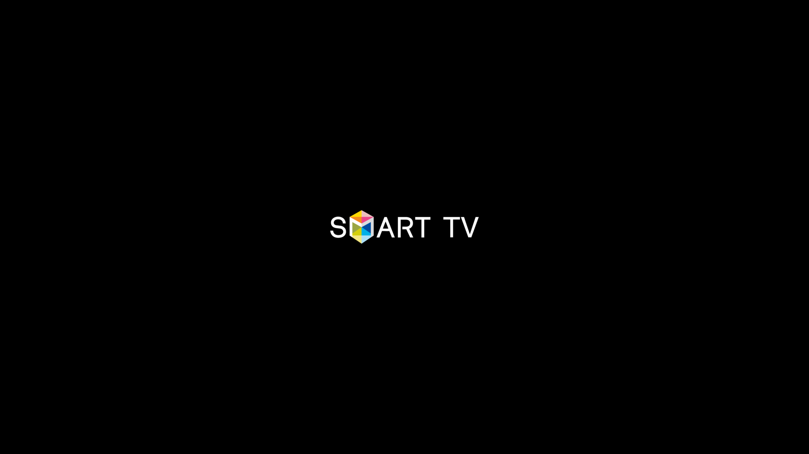

# Captures of the original guest

All six images are lossless 1920×1080 captures of the local QEMU guest,
copied without image edits. [manifest.json](manifest.json) records their
filenames, hashes, sizes and provenance. They show different milestones rather
than a single uninterrupted boot.

## Interactive Smart Hub Apps dashboard

This is the interactive dashboard after setup, with the built-in WebBrowser
selected using normal remote input. Large black regions and incomplete colors
remain. Launching the browser currently produces a black screen.

## Original setup completion

The original wizard reached “Setup complete!” after required agreement.
Optional sharing was left disabled. This state was verified in the retained
VM; persistence after restart remains unverified.

## Original wired network checks

The original firmware completes its gateway and HTTP checks through the
emulated Ethernet device and QEMU user networking. This precedes Hub TLS setup.

## Smart Hub welcome page

This is the original interactive welcome page in the setup flow.

## Smart Hub introduction

The apps grid inside this introduction is Samsung's embedded promotional
image. It is distinct from the interactive dashboard shown above.

## Firmware logo diagnostic

The initial display diagnostic asks the original guest display driver to draw
the firmware's logo. It verifies the early display path independently of full
Orsay application startup.

The later setup/dashboard captures use the research VM's earlier independent
ALU renderer build. The exported patch series includes the subsequently tested
shader lowering. The images document observed behavior rather than screenshots
from a newly booted export build.

Samsung UI artwork and trademarks retain their original ownership.
